# Dossier de Conception – Application « StockPro »
**Projet :** Gestion de Stock Full Stack  
**Niveau :** Licence 3 Informatique  
**Auteurs :** Équipe Projet  
**Version :** 1.0.0  

---

## 1. Présentation Générale & Objectifs

L'application **StockPro** a pour but de remplacer la gestion manuelle (cahiers, Excel) d'une boutique de distribution par une solution web centralisée, temps réel, multi-rôles et sécurisée.

### Principaux objectifs :
1. **Éviter les ruptures de stock** grâce à la gestion d'un seuil d'alerte et des indicateurs visuels.
2. **Garantir l'intégrité des flux** : toute entrée/sortie est tracée avec date, utilisateur et motif.
3. **Contrôle strict des stocks** : interdiction absolue d'un stock négatif via transaction SQL.
4. **Sécurité & Isolation des rôles** : Administrateur, Gestionnaire de stock, Vendeur.

---

## 2. Dictionnaire des Données

| Champ | Type | Description | Contraintes / Exemples |
| :--- | :--- | :--- | :--- |
| **utilisateurs.id** | INT (PK) | Identifiant unique de l'utilisateur | Auto-incrément |
| **utilisateurs.nom** | VARCHAR(100) | Nom complet de l'utilisateur | Non nul |
| **utilisateurs.email** | VARCHAR(150) | Adresse email (identifiant de connexion) | Unique, non nul |
| **utilisateurs.mot_de_passe** | VARCHAR(255) | Hash sécurisé du mot de passe (bcrypt) | Non nul |
| **utilisateurs.role_id** | INT (FK) | Référence au rôle de l'utilisateur | Clé étrangère vers `roles.id` |
| **utilisateurs.actif** | BOOLEAN | Statut du compte (activé / désactivé) | Défaut: `true` |
| **roles.id** | INT (PK) | Identifiant unique du rôle | Auto-incrément |
| **roles.nom** | VARCHAR(50) | Nom du rôle | Unique : `ADMIN`, `GESTIONNAIRE`, `VENDEUR` |
| **roles.description** | VARCHAR(255) | Description des permissions du rôle | Optionnel |
| **categories.id** | INT (PK) | Identifiant de la catégorie | Auto-incrément |
| **categories.nom** | VARCHAR(100) | Nom de la catégorie de produits | Unique, non nul |
| **categories.description** | TEXT | Description de la catégorie | Optionnel |
| **fournisseurs.id** | INT (PK) | Identifiant unique du fournisseur | Auto-incrément |
| **fournisseurs.nom** | VARCHAR(150) | Nom commercial / Raison sociale | Non nul |
| **fournisseurs.email** | VARCHAR(150) | Adresse de contact | Optionnel |
| **fournisseurs.telephone** | VARCHAR(30) | Numéro de téléphone | Optionnel |
| **fournisseurs.adresse** | TEXT | Adresse physique | Optionnel |
| **produits.id** | INT (PK) | Identifiant unique du produit | Auto-incrément |
| **produits.reference** | VARCHAR(50) | Code produit unique (SKU / Barcode) | Unique, non nul |
| **produits.nom** | VARCHAR(150) | Nom / Désignation du produit | Non nul |
| **produits.description** | TEXT | Description détaillée | Optionnel |
| **produits.prix_achat** | DECIMAL(10,2) | Coût unitaire d'achat HT | >= 0 |
| **produits.prix_vente** | DECIMAL(10,2) | Prix unitaire de vente TTC | >= prix_achat |
| **produits.quantite_stock** | INT | Quantité physique en stock | >= 0 (check constraint) |
| **produits.seuil_alerte** | INT | Seuil minimal avant alerte | Défaut: 5, >= 0 |
| **produits.image_url** | VARCHAR(255) | URL / Chemin de l'image | Optionnel |
| **produits.categorie_id** | INT (FK) | Catégorie du produit | Clé étrangère vers `categories.id` |
| **produits.fournisseur_id** | INT (FK) | Fournisseur principal habituel | Clé étrangère (nullable) |
| **mouvements_stock.id** | INT (PK) | Identifiant du mouvement | Auto-incrément |
| **mouvements_stock.produit_id** | INT (FK) | Produit concerné | Clé étrangère |
| **mouvements_stock.utilisateur_id** | INT (FK) | Utilisateur ayant réalisé l'opération | Clé étrangère |
| **mouvements_stock.type** | ENUM | Sens du mouvement | `ENTREE`, `SORTIE` |
| **mouvements_stock.quantite** | INT | Quantité déplacée | > 0 |
| **mouvements_stock.motif** | ENUM / VARCHAR | Motif du mouvement | `ACHAT`, `VENTE`, `PERTE`, `CASSE`, `AJUSTEMENT` |
| **mouvements_stock.date_mouvement** | DATETIME | Horodatage du mouvement | Défaut: CURRENT_TIMESTAMP |
| **commandes_fournisseurs.id** | INT (PK) | Identifiant de la commande | Auto-incrément |
| **commandes_fournisseurs.numero** | VARCHAR(50) | Numéro de bon de commande | Unique, ex: `CMD-2026-0001` |
| **commandes_fournisseurs.fournisseur_id** | INT (FK) | Fournisseur commandé | Clé étrangère |
| **commandes_fournisseurs.utilisateur_id** | INT (FK) | Utilisateur ayant passé la commande | Clé étrangère |
| **commandes_fournisseurs.date_commande** | DATETIME | Date d'émission de la commande | Défaut: CURRENT_TIMESTAMP |
| **commandes_fournisseurs.statut** | ENUM | État du cycle de vie | `EN_ATTENTE`, `PARTIELLEMENT_RECUE`, `RECUE`, `ANNULEE` |
| **commandes_fournisseurs.total_estime** | DECIMAL(10,2) | Total estimé de la commande | >= 0 |
| **lignes_commandes.id** | INT (PK) | Identifiant de la ligne | Auto-incrément |
| **lignes_commandes.commande_id** | INT (FK) | Commande parente | Clé étrangère |
| **lignes_commandes.produit_id** | INT (FK) | Produit commandé | Clé étrangère |
| **lignes_commandes.quantite_commandee**| INT | Quantité demandée | > 0 |
| **lignes_commandes.quantite_recue** | INT | Quantité réceptionnée | Défaut: 0, <= quantite_commandee |
| **lignes_commandes.prix_unitaire** | DECIMAL(10,2) | Prix négocié unitaire | >= 0 |

---

## 3. Modèle Conceptuel des Données (MCD)

### Entités et Associations (Formalisme Merise)

```
[ ROLE ] 1,1 -------- ( Posseder ) -------- 0,N [ UTILISATEUR ]
                                                        |
                                                        | 0,N
                                                        |
                                                 ( Effectuer )
                                                        |
                                                        | 1,1
[ PRODUIT ] 0,N ---- ( Concerner ) ---------- 1,1 [ MOUVEMENT_STOCK ]
   |  |
   |  +--- 0,N ------ ( Fournir ) ----------- 0,1 [ FOURNISSEUR ]
   |                                                    |
   +------ 0,N ------ ( Classer ) ----------- 1,1 [ CATEGORIE ]
   |                                                    |
   |                                                    | 0,N
   | 0,N                                                |
   |                                              ( Passer )
 ( Composer )                                           |
   |                                                    | 1,1
   | 1,N --------------------------------- 1,1 [ COMMANDE_FOURNISSEUR ]
   | [quantite_commandee, quantite_recue, prix_unitaire]
```

### Justification des Relations et Cardinalités :
1. **ROLE - UTILISATEUR (1,1 : 0,N)** : Chaque compte utilisateur est rattaché à un rôle unique (ADMIN, GESTIONNAIRE, VENDEUR) afin d'assurer un contrôle strict d'accès (RBAC).
2. **CATEGORIE - PRODUIT (1,1 : 0,N)** : Un produit appartient toujours à une catégorie commerciale (ex: Alimentaire, Boissons, Informatique). Une catégorie peut contenir plusieurs produits.
3. **FOURNISSEUR - PRODUIT (0,1 : 0,N)** : Un produit a un fournisseur habituel référencé (optionnel). Un fournisseur approvisionne 0 à plusieurs produits.
4. **PRODUIT - MOUVEMENT_STOCK (1,1 : 0,N)** : Chaque mouvement enregistre une variation de stock sur un produit spécifique.
5. **UTILISATEUR - MOUVEMENT_STOCK (1,1 : 0,N)** : Obligation d'identifier l'utilisateur auteur de chaque mouvement pour assurer la traçabilité et l'audit.
6. **COMMANDE_FOURNISSEUR - FOURNISSEUR (1,1 : 0,N)** : Une commande fournisseur est émise vers un fournisseur déterminé.
7. **COMMANDE_FOURNISSEUR - PRODUIT via LIGNE_COMMANDE (Relation N-N porteuse)** : Une commande regroupe plusieurs lignes de produits avec quantités commandées, quantités reçues et prix unitaire.

---

## 4. Modèle Logique des Données (MLD Relationnel)

- **roles** (<ins>id</ins>, nom, description)
- **utilisateurs** (<ins>id</ins>, nom, email, mot_de_passe, #role_id, actif, created_at, updated_at)
- **categories** (<ins>id</ins>, nom, description, created_at)
- **fournisseurs** (<ins>id</ins>, nom, email, telephone, adresse, created_at)
- **produits** (<ins>id</ins>, reference, nom, description, prix_achat, prix_vente, quantite_stock, seuil_alerte, image_url, #categorie_id, #fournisseur_id, created_at, updated_at)
- **mouvements_stock** (<ins>id</ins>, #produit_id, #utilisateur_id, type, quantite, motif, date_mouvement)
- **commandes_fournisseurs** (<ins>id</ins>, numero, #fournisseur_id, #utilisateur_id, date_commande, statut, total_estime, created_at, updated_at)
- **lignes_commandes** (<ins>id</ins>, #commande_id, #produit_id, quantite_commandee, quantite_recue, prix_unitaire)

---

## 5. Diagramme des Cas d'Utilisation UML (RBAC)

```mermaid
graph TD
    subgraph Acteurs
        Admin((Administrateur))
        Gest((Gestionnaire de Stock))
        Vend((Vendeur))
    end

    subgraph Module_Auth ["Module 1: Authentification"]
        UC1[Se connecter / Se déconnecter]
        UC2[Gérer les comptes utilisateurs & rôles]
    end

    subgraph Module_Catalogue ["Module 2: Catalogue & Fournisseurs"]
        UC3[Consulter le catalogue & rechercher des produits]
        UC4[CRUD Produits, Catégories, Fournisseurs]
    end

    subgraph Module_Stock ["Module 3: Mouvements de Stock"]
        UC5[Enregistrer une sortie de stock: Vente]
        UC6[Enregistrer une entrée manuelle ou régularisation]
        UC7[Consulter l'historique complet des mouvements]
    end

    subgraph Module_Commandes ["Module 4: Commandes Fournisseurs"]
        UC8[Créer une commande fournisseur]
        UC9[Réceptionner une commande et incrémenter le stock]
    end

    subgraph Module_Dashboard ["Module 5: Dashboard & Statistiques"]
        UC10[Consulter les alertes de rupture]
        UC11[Visualiser les KPIs financiers et graphiques d'évolution]
    end

    Admin --> UC1
    Admin --> UC2
    Admin --> UC3
    Admin --> UC4
    Admin --> UC5
    Admin --> UC6
    Admin --> UC7
    Admin --> UC8
    Admin --> UC9
    Admin --> UC10
    Admin --> UC11

    Gest --> UC1
    Gest --> UC3
    Gest --> UC4
    Gest --> UC6
    Gest --> UC7
    Gest --> UC8
    Gest --> UC9
    Gest --> UC10
    Gest --> UC11

    Vend --> UC1
    Vend --> UC3
    Vend --> UC5
    Vend --> UC10
```



---

## 6. Architecture Technique et Arborescence Prévue

```
gestiondestock/
├── docs/                        # Livrables & Conception
│   ├── CONCEPTION.md            # Ce dossier de conception
│   └── API_SPEC.md              # Spécification OpenAPI / REST
├── backend/                     # API REST (Node.js + Express + Prisma ORM)
│   ├── prisma/                  # Schéma de base de données & migrations
│   │   └── schema.prisma
│   ├── src/
│   │   ├── config/              # Base de données, JWT, environnement
│   │   ├── controllers/         # Logique métier des endpoints
│   │   ├── middlewares/         # Auth JWT, vérification des rôles, validateurs
│   │   ├── routes/              # Définitions des routes d'API (/api/v1/...)
│   │   ├── services/            # Services métier (calcul stock, transactions)
│   │   └── server.js            # Point d'entrée de l'API
│   ├── package.json
│   └── .env.example
├── frontend/                    # Application Web Client (React + Vite + Vanilla CSS)
│   ├── src/
│   │   ├── assets/              # Logos, icônes
│   │   ├── components/          # Composants réutilisables (Navbar, Modal, Table, Badge, Card)
│   │   ├── context/             # AuthContext (JWT, rôle, user connecté)
│   │   ├── pages/               # Vues : Dashboard, Produits, Mouvements, Commandes, Utilisateurs
│   │   ├── services/            # Client HTTP Axios / Fetch vers l'API
│   │   ├── styles/              # Design System moderne, variables CSS, Dark mode
│   │   ├── App.jsx
│   │   └── main.jsx
│   ├── package.json
│   └── vite.config.js
└── README.md                    # Guide de démarrage complet
```

---

## 7. Règles Métier Critiques à Respecter

1. **Règle R1 (Atomicité du Stock) :** Toute sortie de stock (vente, casse) doit être exécutée dans une **transaction SQL**. Si la quantité disponible est inférieure à la quantité demandée, la transaction est annulée avec une erreur `400 Bad Request: Stock insuffisant`.
2. **Règle R2 (Génération de Mouvement) :** La modification du stock d'un produit ne se fait **JAMAIS** par un simple update direct sans écriture concomitante dans la table `mouvements_stock`.
3. **Règle R3 (Sécurisation des Endpoints) :**
   - Vendeur : uniquement lecture catalogue + création de sorties de type `VENTE`.
   - Gestionnaire : catalogue complet, commandes fournisseurs, réceptions de stock, alertes.
   - Administrateur : plein pouvoir y compris gestion des utilisateurs et suppression d'enregistrements sensibles.
